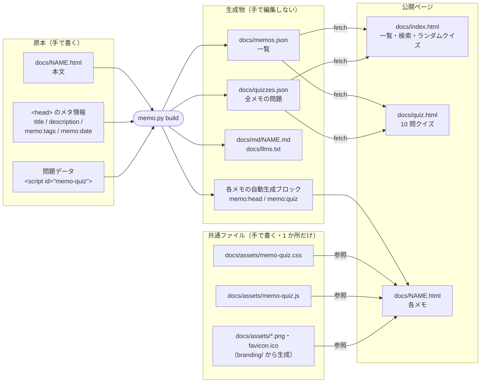
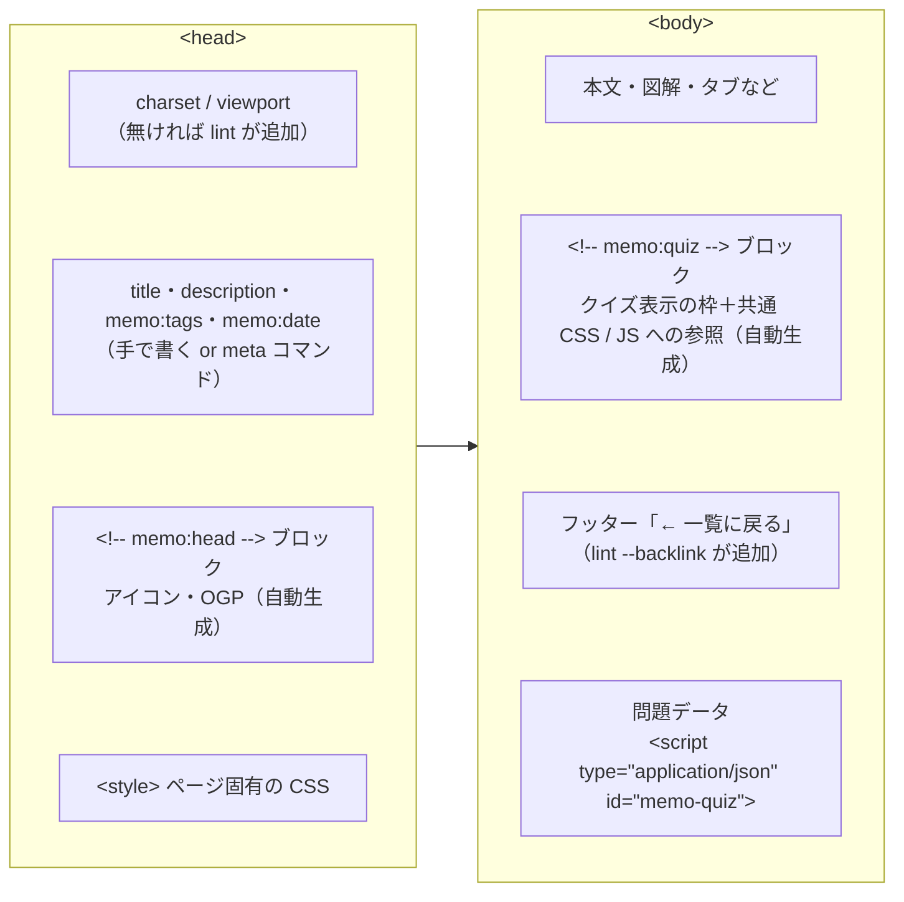
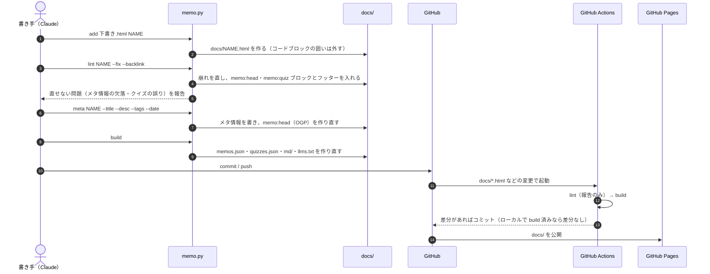
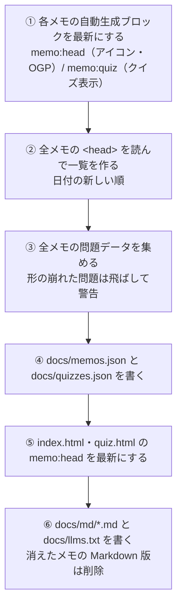
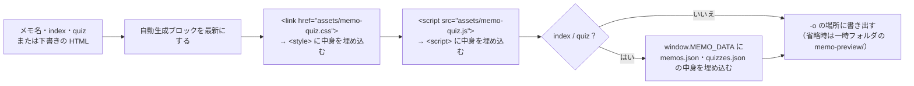
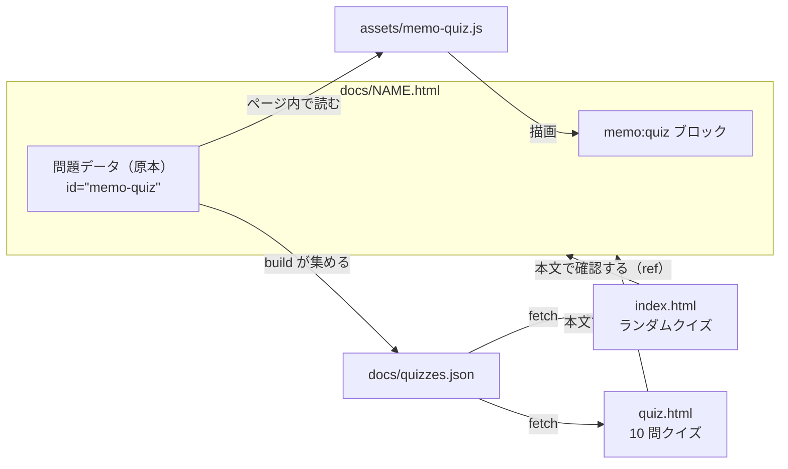
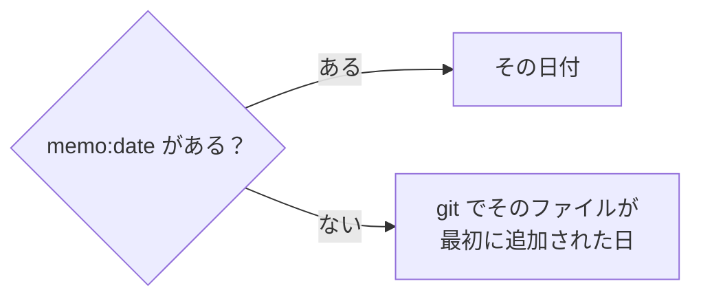
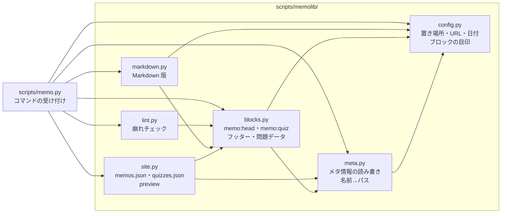

# memo.py の仕組み

`scripts/memo.py` は、MEMO リポジトリのメモ（`docs/*.html`）を登録・点検し、一覧や AI 向けの Markdown 版を生成するツールです。
入口は `scripts/memo.py`、処理の本体は `scripts/memolib/` にあり、テストは `tests/` にあります。
標準ライブラリだけで動き、どのディレクトリから実行してもかまいません。

使い方の入口は [README](README.md)、ページのデザイン規約とクイズの書き方は [memo-style](.claude/skills/memo-style/SKILL.md)、登録の手順は [memo-publish](.claude/skills/memo-publish/SKILL.md) にあります。このファイルは「スクリプトが何をどこに書くか」の説明です。

## 目次

- [基本の考え方](#基本の考え方)
- [全体像：原本と生成物](#全体像原本と生成物)
- [メモ 1 本の中身](#メモ-1-本の中身)
- [コマンド一覧](#コマンド一覧)
- [登録の流れ](#登録の流れ)
- [各コマンドの詳細](#各コマンドの詳細)
- [自動生成ブロック](#自動生成ブロック)
- [確認クイズのデータの流れ](#確認クイズのデータの流れ)
- [AI 向けの Markdown 版](#ai-向けの-markdown-版)
- [日付と URL の決まり方](#日付と-url-の決まり方)
- [表示の確認とプレビュー](#表示の確認とプレビュー)
- [GitHub Actions](#github-actions)
- [コードの構成とテスト](#コードの構成とテスト)
- [変更したいときはどこを触るか](#変更したいときはどこを触るか)

## 基本の考え方

- **原本は人（または Claude）が書く。それ以外はすべて生成する。** 原本は各メモの本文・`<head>` のメタ情報・クイズの問題データの 3 つだけで、一覧や Markdown 版、各ページに差し込むタグはスクリプトが作ります。生成されたものは手で編集しません（次の `build` で上書きされます）。
- **同じものを 2 か所に書かない。** クイズの表示（CSS / JS）は `docs/assets/memo-quiz.*` に 1 つだけ置き、各メモは参照するだけです。
- **置き場所を知っているのはスクリプトだけ。** メモは名前（`docker` など）で指定し、パスは `memo.py path NAME` で引きます。スキル側でパスを組み立てません。
- **公開されるのは `docs/` だけ。** GitHub Pages の公開元が `docs/` なので、スクリプト・スキル・このファイルは公開されません。

## 全体像：原本と生成物



| ファイル | 種類 | 作る人 | 中身 |
| --- | --- | --- | --- |
| `docs/NAME.html` | メモ | 人＋スクリプト | 本文とメタ情報と問題データは人が書く。`memo:head`・`memo:quiz` ブロックはスクリプトが入れる |
| `docs/index.html` | トップページ | 人 | 一覧・検索・タグ絞り込み・ランダムクイズ。データは JSON から読む |
| `docs/quiz.html` | クイズページ | 人 | ランダム 10 問・カテゴリ別 10 問。データは JSON から読む |
| `docs/memos.json` | 生成物 | `build` | 全メモのタイトル・説明・タグ・日付・問題数 |
| `docs/quizzes.json` | 生成物 | `build` | 全メモの問題（どのメモの問題かも含む）。1 問 1 行 |
| `docs/md/NAME.md` | 生成物 | `build` | 各メモの本文を Markdown にしたもの |
| `docs/llms.txt` | 生成物 | `build` | 全メモの目次（Markdown 版へのリンク） |
| `docs/assets/memo-quiz.css`・`.js` | 共通ファイル | 人 | 確認クイズの見た目と動き |
| `docs/assets/*.png`・`favicon.ico` | 共通ファイル | `branding/render.py` | アイコンと OGP 画像 |
| `.claude/skills/memo-style/template.html` | テンプレート | 人 | `new` で新しいメモを作るときの雛形 |

## メモ 1 本の中身



一覧に載る情報は `<head>` から読みます。

```html
<title>Docker 動作原理</title>
<meta name="description" content="1 文の説明">
<meta name="memo:tags" content="Docker, Linux">
<meta name="memo:date" content="2026-10-31">
```

- タイトルは `<meta name="memo:title">` があればそちらを優先し、無ければ `<title>`、それも無ければファイル名。
- タグはカンマ区切り。表記ゆれを防ぐため、既存のタグ（`memo.py list` で見られる）を使い回します。
- 日付の決まり方は[日付と URL の決まり方](#日付と-url-の決まり方)を参照。

問題データの書式と作問ルールは [memo-style の「確認クイズ」](.claude/skills/memo-style/SKILL.md) にあります。

```html
<script type="application/json" id="memo-quiz">
[{"q": "問題文", "choices": ["A", "B", "C"], "answer": 0, "explain": "解説", "ref": "#見出しのid"}]
</script>
```

## コマンド一覧

```bash
python3 scripts/memo.py <コマンド> ...
```

| コマンド | 使い方 | やること | ファイルを書き換えるか |
| --- | --- | --- | --- |
| `new` | `new NAME` | テンプレートから `docs/NAME.html` を作る | 作る |
| `add` | `add SRC NAME [--force]` | 外部の HTML を `docs/NAME.html` として取り込む | 作る（`--force` で上書き） |
| `path` | `path NAME [--md]` | メモ（または Markdown 版）の絶対パスを表示 | しない |
| `url` | `url [NAME]` | 公開 URL を表示 | しない |
| `lint` | `lint MEMO... [--fix] [--backlink]` | 崩れのチェック。`--fix` で直せるものを直す | `--fix` のときだけ |
| `meta` | `meta MEMO [--title] [--desc] [--tags] [--date]` | メタ情報を設定する | する |
| `build` | `build [--check]` | 生成物をすべて作り直す。`--check` は古いかどうかだけ調べる | `--check` 以外はする |
| `list` | `list` | メモの一覧（日付・名前・タイトル・タグ）を表示 | しない |
| `preview` | `preview MEMO\|index\|quiz\|FILE [-o OUT]` | 共通ファイルを埋め込んだ 1 枚の HTML を書き出す | 元のファイルはしない |

`MEMO` / `NAME` は `docker`・`docker.html`・`docs/docker.html` のどれでもよく、既存のファイルパスを渡せばそのファイルが対象になります（下書きの点検に使えます）。
名前は英小文字・数字・ハイフンだけで、`index` と `quiz` は特別なページなのでメモ名に使えません。

## 登録の流れ

[memo-publish](.claude/skills/memo-publish/SKILL.md) の手順を、スクリプトの動きで見るとこうなります。



GitHub の画面から HTML を直接アップロードした場合も、Actions の `build` が自動生成ブロックと一覧を作るので、一覧に載ります。

## 各コマンドの詳細

### new / add

- `new` は `.claude/skills/memo-style/template.html` をコピーするだけです。同名のファイルがあれば止まります。
- `add` は外部の HTML を取り込みます。Markdown のコードブロック（```` ```html ... ``` ````）に包まれていれば中身だけを取り出します。同名のファイルがあれば止まり、`--force` で上書きします。

### lint

`lint` は「自動で直せるもの」と「人が直すもの（`[要対応]`）」を分けて報告します。`--fix` を付けたときだけ書き込みます。

| 分類 | 内容 |
| --- | --- |
| 直す | `<style>` 内の全角クォート `‘’“”`（コピペで化けて font-family などが効かなくなる） |
| 直す | `* {` が `- {` や `\*` に化けたもの（Markdown 経由のコピペで起きる） |
| 直す | `<!DOCTYPE html>`・charset・viewport の欠落 |
| 直す | フッターの「← 一覧に戻る」リンク（`--backlink` のとき。無ければ追加） |
| 直す | `memo:head` ブロック（アイコン・OGP）の追加／更新 |
| 直す | `memo:quiz` ブロック（クイズ表示）の追加／更新 |
| 報告 | JS 内で全角クォートが文字列の区切りに使われている疑い |
| 報告 | タイトル・説明・タグ・日付の欠落 |
| 報告 | 一覧へのリンクが無い（`--backlink` を付けていないとき） |
| 報告 | クイズの JSON の崩れ・形の誤り・`ref` の飛び先が無い・正解の位置が全問同じ |

終了コードは、報告が残るか、`--fix` なしで直せるものがあれば 1、それ以外は 0 です。

### meta

指定した項目だけを書き換え、最後に自動生成ブロックを作り直します（OGP のタイトル・説明が新しいメタ情報に追従します）。

- `--tags` はカンマ区切りで渡し、前後の空白を整えて保存します。
- `--date` は値を付ければその日付、値なしなら**日本時間の今日**です（[日付と URL の決まり方](#日付と-url-の決まり方)）。

### build

`build` は次の順に処理します。どれも「内容が変わったときだけ」書き込みます。



- `--check` は何も書き込まず、古いファイルがあれば名前を表示して終了コード 1 を返します。
- `memos.json` の各メモには、そのメモの問題数（`quizzes`）も入ります。トップページはこれを足してランダムクイズの問題数を表示し、問題本体（`quizzes.json`）はランダムクイズを開いたときに初めて読み込みます。

### list / path / url

- `list` は `日付  ファイル名  タイトル  [タグ]` の形で全メモを表示します。
- `path NAME` は `docs/NAME.html` の絶対パス、`--md` を付けると `docs/md/NAME.md` のパスを表示します。
- `url NAME` は公開 URL を表示します（名前なしならトップ）。

### preview

公開するページは共通ファイル（クイズの CSS / JS、一覧の JSON）を読み込むので、HTML 1 枚だけを渡す場面（会話内のプレビューなど）では動きません。`preview` はそれらを埋め込んだコピーを書き出します。元のファイルは変更しません。



埋め込む中身は公開版と同じファイルから取るので、見た目と動きは公開版と変わりません。トップページとクイズページは、`window.MEMO_DATA` があればそれを使い、無ければ JSON を fetch します。

## 自動生成ブロック

各ページに差し込まれるブロックです。開始と終了のコメントで囲まれていて、毎回まるごと作り直されるので、中を手で編集しても消えます。

| ブロック | 入る場所 | 中身 | 作るもの |
| --- | --- | --- | --- |
| `<!-- memo:head -->` 〜 `<!-- /memo:head -->` | `</head>` の直前 | ファビコン・iOS アイコン・OGP（`og:title` / `og:description` は title / description から） | `lint`・`meta`・`build`・`preview` |
| `<!-- memo:quiz -->` 〜 `<!-- /memo:quiz -->` | フッターの直前（無ければ `</body>` の直前） | クイズ表示の枠と、`assets/memo-quiz.css`・`.js` への参照。問題データが無いメモには入らない | `lint`・`meta`・`build`・`preview` |
| `<footer id="memo-backlink">` | `</body>` の直前 | 「← 一覧に戻る」リンク。スタイルはインラインで完結 | `lint --backlink`（無いときだけ追加） |

## 確認クイズのデータの流れ

問題の原本は各メモの中にだけあり、ほかはすべてそこから作られます。



- `ref`（`"#見出しのid"`）があると、間違えたときに本文の該当箇所へのリンクが出ます。飛び先が閉じたタブや `<details>` の中にあれば、`memo-quiz.js` が開いてから移動します。
- 問題を直すときは各メモの問題データだけを直し、`build` で `quizzes.json` に反映します。

## AI 向けの Markdown 版

`build` は Claude などが HTML（CSS・SVG 込みで重い）を読まずに中身を把握できるよう、本文を Markdown にした版を作ります。

| 出力 | 中身 |
| --- | --- |
| `docs/llms.txt` | 全メモの目次。タイトル・説明・タグ・日付と、各 Markdown 版へのリンク |
| `docs/md/NAME.md` | 冒頭にタイトル・説明・URL・タグ・日付、続けて本文 |

変換のルール:

- `<head>`・CSS・JS・クイズの表示ブロック・フッターは除きます。問題データは本文に含めません。
- SVG の図は、中の文字（ラベル）だけを残します。
- 図や操作できるパーツがある節には、元のページのその節へのリンクを付けます。
- 本文の大半を JavaScript のデータから描画するページは、HTML からは中身が取れないので、そのスクリプトをコードブロックとして末尾に付けます。
- 別のメモへのリンクは、そのメモの Markdown 版へのリンクに置き換えます。

公開 URL は `https://memo.taka1156.site/llms.txt` です。リポジトリを繋いでいない会話でも、この URL を渡せば Claude が過去のメモを参照できます。

## 日付と URL の決まり方

**日付（`memo:date`）**



- `meta --date` を値なしで実行すると、**日本時間（UTC+9）の今日**が入ります。実行環境の時計が UTC でも、日本時間の朝 9 時前に前日の日付になることはありません。
- `meta --date 2026-11-04` のように値を付ければその日付になります。
- 登録後は `memo.py list` で日付を確認します。

**URL**

- 公開 URL は `docs/CNAME` の独自ドメインから決まります（無ければ `https://taka1156.github.io/memo/`）。`og:url`・`og:image` の絶対 URL にも使います。
- `og:image` には `og.png` の中身から作った短いハッシュ（`?v=…`）を付けます。画像を差し替えると URL が変わり、SNS 側の画像キャッシュが古いまま残るのを防げます。
- アイコンと OGP 画像の生成元は `branding/`（`og.html`・`icon.html`）で、`python3 branding/render.py` で `docs/assets/` に書き出します（`branding/` は公開されません）。

## 表示の確認とプレビュー

公開ページは共通ファイルを読み込むので、開き方によって表示が変わります。

| 開き方 | 各メモのクイズ | トップの一覧・ランダムクイズ | クイズページ |
| --- | --- | --- | --- |
| 公開サイト（GitHub Pages） | 動く | 動く | 動く |
| ローカルサーバー `python3 -m http.server -d docs` | 動く | 動く | 動く |
| `memo.py preview` で作った 1 枚 | 動く | 動く | 動く |
| HTML ファイルを直接開く・そのまま会話に送る | 出ない | 「読み込めませんでした」と表示 | 「読み込めませんでした」と表示 |

会話内で下書きを見せるときの手順は [memo-style の「会話内でプレビューするとき」](.claude/skills/memo-style/SKILL.md) にあります。

```bash
python3 scripts/memo.py lint 下書き.html --fix --backlink
python3 scripts/memo.py preview 下書き.html -o /tmp/NAME.html
```

## GitHub Actions

`.github/workflows/build-index.yml` が、master への push で生成物を作り直します。

| 項目 | 内容 |
| --- | --- |
| 起動する変更 | `docs/*.html`・`docs/CNAME`・`scripts/` 以下・`docs/assets/og.png`（手動実行も可） |
| 手順 | 履歴ごと checkout（日付の推定に使う）→ 全メモを `lint`（報告のみ）→ `build` |
| コミット | `docs/` に変更（新しく生成されたファイルを含む）があれば `Rebuild MEMO index` としてコミット・push |

ローカルで `build` してから push していれば、Actions 側では差分が出ません。

もう 1 つの `.github/workflows/test.yml`（`Test memo.py`）は、`scripts/`・`tests/`・クイズの共通ファイル・テンプレートが変わったとき（PR も含む）にテストを流します。リポジトリは書き換えません。

## コードの構成とテスト

入口の `scripts/memo.py` はコマンドを受け付けるだけで、処理の本体は `scripts/memolib/` に役割ごとに分かれています。
コードを直すときの手順（テストの流し方、出力が変わっていないことの確かめ方、更新するドキュメント）は [memo-maintain](.claude/skills/memo-maintain/SKILL.md) にあります。



矢印は「使っている」向きです。依存は一方向（`config` ← `meta` ← `blocks` ← `lint`・`markdown`・`site` ← `memo.py`）で、逆向きの import はありません。

| ファイル | 役割 | 主な関数 |
| --- | --- | --- |
| `scripts/memo.py` | コマンドの受け付け | `cmd_build`・`cmd_lint`・`cmd_preview` など、`main` |
| `memolib/config.py` | 置き場所・公開 URL・日付（日本時間）・自動生成ブロックの目印 | `today_jst`・`site_url`・`asset_version` |
| `memolib/meta.py` | `<head>` のメタ情報の読み書き、名前からパスへの解決 | `read_meta`・`set_meta`・`memo_path`・`memo_files` |
| `memolib/blocks.py` | 自動生成ブロック、「一覧に戻る」フッター、クイズの問題データ | `head_block`・`apply_quiz`・`apply_generated`・`read_quiz`・`validate_quiz` |
| `memolib/lint.py` | 崩れのチェックと自動修正 | `lint_text` |
| `memolib/markdown.py` | AI 向けの Markdown 版 | `html_to_markdown`・`memo_markdown`・`llms_txt`・`build_markdown` |
| `memolib/site.py` | 一覧・問題の JSON、会話内プレビュー用の 1 枚の HTML | `site_data`・`memos_json`・`quizzes_json`・`preview_text` |

多くの関数は「HTML の文字列を受け取って文字列を返す」だけで、ファイルを書き換えるのは `memo.py` の各コマンドです。そのため関数単位でテストできます。

### テスト

標準ライブラリの `unittest` だけで動きます。リポジトリを一時フォルダにコピーして動かすので、リポジトリ自体は書き換えません。

```bash
python3 -B -m unittest discover -s tests       # 全部（15 秒ほど）
python3 -B tests/snapshot.py OUTDIR            # 全コマンドの出力を保存（前後比較用）
```

| ファイル | 中身 |
| --- | --- |
| `tests/test_cli.py` | コマンドを外から動かす結合テスト。生成物が最新か、生成物を全部消して `build` するとリポジトリと同じ中身に戻るか、2 回目の `build` で何も変わらないか、`lint --fix`・`new`・`add`・`meta`・`preview` の動きなど |
| `tests/test_units.py` | 関数ごとの単体テスト。日本時間の日付、問題データの検証、ブロックの差し込み位置と冪等性、CSS の化けの修正、Markdown 変換、`</script>` のエスケープなど |
| `tests/snapshot.py` | テストではなく道具。全メモの `build`・`lint`・`preview` と各コマンドの出力をフォルダに保存する。リファクタリングの前後で 1 回ずつ実行し、`diff -r` で何も出なければ出力は変わっていない |
| `tests/helpers.py` | リポジトリを一時フォルダにコピーした「作業用リポジトリ」を作る共通処理 |

## 変更したいときはどこを触るか

| 変えたいもの | 触るファイル | その後 |
| --- | --- | --- |
| メモの本文・問題 | `docs/NAME.html` | `lint NAME` → `build` |
| タイトル・説明・タグ・日付 | `meta NAME ...` | `build` |
| 確認クイズの見た目・動き | `docs/assets/memo-quiz.css`・`.js` | 何もしなくてよい（全メモに反映） |
| クイズ表示の枠（HTML）・入る場所 | `memolib/blocks.py` の `QUIZ_BLOCK`・`apply_quiz` | `build`（全メモが書き換わる） |
| アイコン・OGP のタグ | `memolib/blocks.py` の `head_block` | `build`（全ページが書き換わる） |
| アイコン・OGP 画像 | `branding/` | `python3 branding/render.py` → `build` |
| トップページ・クイズページの見た目 | `docs/index.html`・`docs/quiz.html` | 何もしなくてよい |
| 一覧に載せる項目 | `memolib/meta.py` の `read_meta`、`memolib/site.py` の `memos_json` | `build` |
| Markdown 版の変換ルール | `memolib/markdown.py` の `_ToMarkdown`・`html_to_markdown` | `build`（全 Markdown 版が書き換わる） |
| 新しいメモの雛形 | `.claude/skills/memo-style/template.html` | 何もしなくてよい |
| 公開ドメイン | `docs/CNAME` | `build`（OGP の URL が変わる） |
| 上の表にないスクリプトの処理 | `scripts/memolib/` の該当モジュール（[コードの構成とテスト](#コードの構成とテスト)） | [memo-maintain](.claude/skills/memo-maintain/SKILL.md) の手順でテストと前後比較 |
